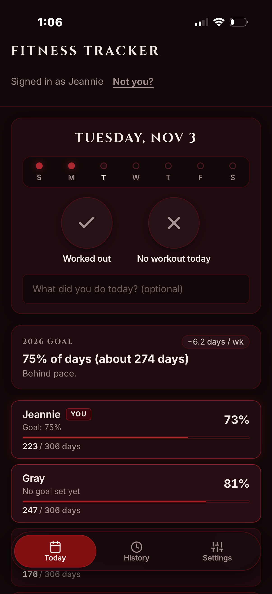
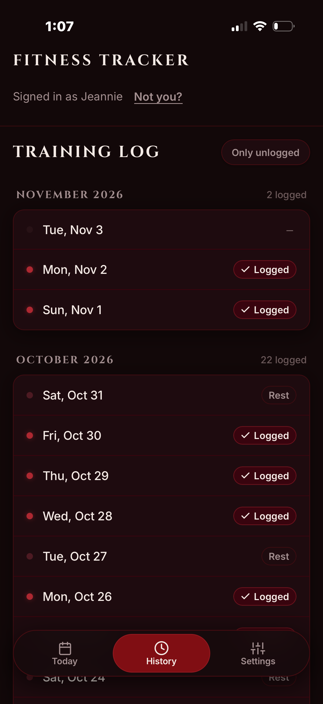
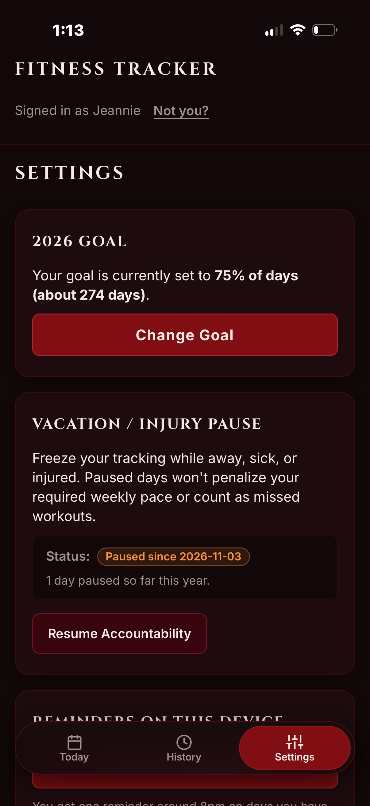
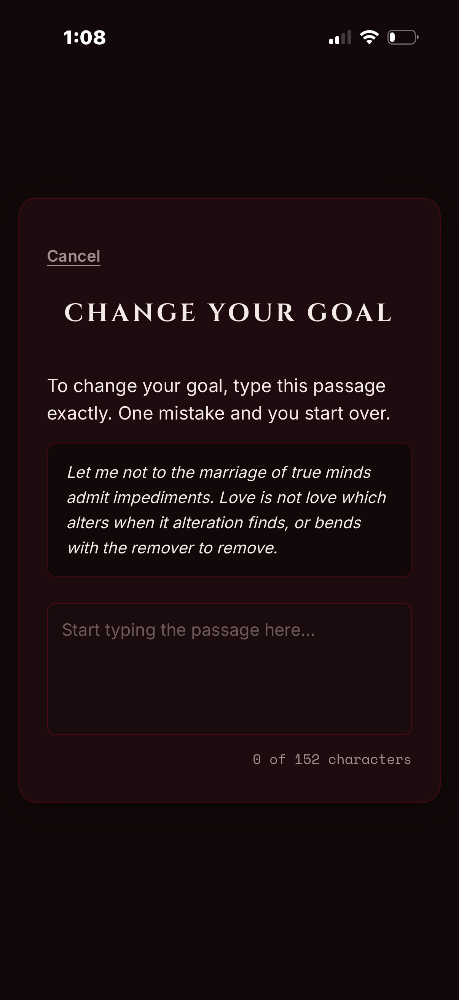

# Fit Tracker: Group Accountability & Predictive Goal Pacing

A mobile-first, privacy-focused Progressive Web Application (PWA) engineered to replace brittle shared spreadsheets with **real-time statistical pacing**, **behavioral commitment devices**, and a **bespoke gothic aesthetic**.

Built for a small group of athletes to track daily workouts, normalize fair accountability during illness or travel, and dynamically calculate the required training volume needed to hit annual milestones.

---

## Interface Showcase

<p align="center">
  
  &nbsp;&nbsp;
  
  &nbsp;&nbsp;
  
  &nbsp;&nbsp;
  
</p>

<p align="center">
  <em>Screenshots: (1) Today view with 7-day dot tracker and group leaderboard &bull; (2) Historical training log and backfill ledger &bull; (3) Vacation/Injury pause accountability toggle &bull; (4) Behavioral friction typing passage.</em>
</p>

---

## Portfolio Focus: Data, Design & Engineering

### 1. Data Science & Mathematical Modeling

* **Dynamic Goal Feasibility & Pacing Engine:**
  Unlike static goal trackers that divide by 52 weeks, the app calculates an adaptive real-time required pace based on actual days remaining in the year:
  $$\text{Workouts Needed } (W_{\text{needed}}) = \max(0, W_{\text{goal}} - W_{\text{completed}})$$
  $$\text{Days Remaining } (D_{\text{remaining}}) = \max(1, D_{\text{year}} - D_{\text{elapsed}})$$
  $$\text{Required Weekly Pace } (P_{\text{req}}) = \left( \frac{W_{\text{needed}}}{D_{\text{remaining}}} \right) \times 7$$
  If $P_{\text{req}} > 7.0$ (requiring more workout days than exist in a week), the system triggers an unfeasible goal alert modal prompting realistic calibration.

* **Vacation & Injury Normalization (Freeze Mode):**
  A common failure mode in fitness trackers is streak punishment during illness or travel. The app implements mathematical normalization:
  $$D_{\text{effective}} = 365 - D_{\text{paused}}$$
  $$W_{\text{goal, adjusted}} = \mathrm{round}\left(D_{\text{effective}} \times \frac{\text{Goal \%}}{100}\right)$$
  Cumulative paused intervals subtract from elapsed calendar time, ensuring athletes are neither penalized nor rewarded for recovery periods.

* **Deterministic Calendar Arithmetic & Zero Time-Zone Drift:**
  Eliminates Daylight Saving Time (DST) skews and UTC midnight boundary bugs by decoupling calendar dates from JavaScript timestamps. All dates are modeled as pure ISO `YYYY-MM-DD` strings with localized UTC date parsing, guaranteeing that a workout logged at 11:30 PM in Arizona never rolls into tomorrow.

* **Non-Punitive Percentage Denominator:**
  Workout completion percentages are computed strictly against *logged* days rather than calendar days elapsed. A member's percentage never artificially plunges at 7:00 AM before their morning run.

---

### 2. Product Design & Behavioral UX

* **Bespoke Visual Identity ("Gothic Modernism"):**
  Rejects generic corporate SaaS templates in favor of a dark gothic aesthetic inspired by medieval manuscripts and minimalist typography:
  * **Color Palette:** Obsidian Black (`#120809`), Oxblood (`#640D14`), Blood Crimson (`#AD2831`), and Bone White (`#F5EBE6`).
  * **Typographic Hierarchy:** Classical Roman display headings ([Cinzel](https://fonts.google.com/specimen/Cinzel)), clean UI labels ([Inter](https://fonts.google.com/specimen/Inter)), and tabular data/telemetry ([Space Mono](https://fonts.google.com/specimen/Space+Mono)).

* **Behavioral Friction as a Feature (Commitment Device):**
  Changing an annual fitness goal after setting it introduces a psychological barrier: the user must type an excerpt from Shakespeare's Sonnet 116 with **100% precision**. Smart quotes, auto-correct, paste events, and drag-and-drop are blocked in the browser. A single typo resets the passage. This behavioral nudge eliminates impulsive goal reductions while remaining fast-tracked if the goal is mathematically unreachable.

* **Ergonomics & Tactile Micro-Interactions:**
  * **Weekly Dot Tracker:** A 7-day activity visualizer starting on Sunday with subtle pulsing glow animations for today's completed workouts.
  * **One-Tap Logging:** Massive circular action targets engineered for quick thumb interaction immediately post-workout.
  * **Zero Emojis:** 100% hand-crafted inline SVG iconography preserving a cohesive aesthetic.

* **Mobile-First Progressive Web App (PWA):**
  Configured with standalone display manifests, dynamic status-bar styling (`black-translucent`), and viewport padding (`viewport-fit=cover`) optimized for iOS Safari notch and home-indicator safe areas.

---

### 3. Full-Stack Architecture & Engineering

```
┌────────────────────────────────────────────────────────┐
│                   React 19 + TypeScript                │
│       (Strict Mode, Custom Hooks, Functional UI)       │
└───────────────────────────┬────────────────────────────┘
                            │
               ┌────────────┴────────────┐
               ▼                         ▼
   ┌───────────────────────┐ ┌───────────────────────┐
   │    MockDataClient     │ │  SupabaseDataClient   │
   │  (In-Memory / Testing)│ │   (PostgreSQL / RLS)  │
   └───────────────────────┘ └───────────┬───────────┘
                                         │
                         ┌───────────────┴───────────────┐
                         ▼                               ▼
              ┌─────────────────────┐         ┌─────────────────────┐
              │  PostgreSQL (ACID)  │         │  Vercel Serverless  │
              │  RPCs + Row-Level   │◄────────┤    Cron Pipeline    │
              │   Security (RLS)    │         │  (Web Push / APNs)  │
              └─────────────────────┘         └─────────────────────┘
```

* **Type-Safe Inversion of Control (Dual-Client Pattern):**
  The entire data layer implements a unified `DataClient` TypeScript interface. The app can switch between a production `SupabaseDataClient` and a self-contained `MockDataClient` that generates deterministic pseudo-random training histories for seamless offline development and live demos without database credentials.

* **PostgreSQL Row-Level Security & Stored Procedures (RPCs):**
  * Direct table updates are locked down behind Row Level Security (RLS).
  * Data modifications run through atomic PL/pgSQL stored procedures (`set_goal`, `set_member_pause_state`, `get_group_stats`), guaranteeing transactional ACID integrity and preventing client-side race conditions.
  * Shared group authentication uses `pgcrypto` Blowfish crypt hashing (`crypt()`), requiring no third-party OAuth bloat.

* **Automated Web Push Pipeline:**
  * Background reminders run on a Vercel Serverless Cron scheduled at 03:20 UTC (8:20 PM MST).
  * Integrates the Web Push protocol (VAPID) directly with Apple Push Notification Service (APNs) and Google FCM.
  * Dynamic message generation computes group log tallies and suppresses alerts for members who have already logged or are currently on Vacation Pause.

* **Rigorous Test Suite:**
  Comprehensive unit test suite powered by [Vitest](https://vitest.dev/), covering calendar leap-year edge cases, dynamic pace formulas, friction passage validation, and Web Push message generators.

---

## Mathematical Formulation Reference

| Metric | Formula | Description |
| :--- | :--- | :--- |
| **Logged Day Percentage** | $P = \frac{W_{\text{logged}}}{D_{\text{logged}}} \times 100$ | Percentage of logged days where a workout was completed. |
| **Days Needed (Days Goal)** | $W_{\text{needed}} = \max(0, G_{\text{days}} - W_{\text{completed}})$ | Workouts required to hit an absolute day target. |
| **Days Needed (Percent Goal)** | $W_{\text{needed}} = \max\left(0, \mathrm{round}\left(D_{\text{eff}} \times \frac{G_{\text{percent}}}{100}\right) - W_{\text{completed}}\right)$ | Workouts required to hit a percentage target over the effective year. |
| **Effective Days** | $D_{\text{eff}} = D_{\text{year}} - D_{\text{paused}}$ | Total calendar days in year adjusted for cumulative pause periods. |
| **Active Days Elapsed** | $D_{\text{active}} = D_{\text{year, elapsed}} - D_{\text{paused, elapsed}}$ | Calendar days elapsed excluding paused/freeze days. |
| **Required Weekly Pace** | $P_{\text{req}} = \left(\frac{W_{\text{needed}}}{\max(1, D_{\text{eff}} - D_{\text{active}})}\right) \times 7$ | Real-time weekly workouts needed to hit goal by year-end. |
| **Feasibility Boundary** | $P_{\text{req}} > 7.0 \iff W_{\text{needed}} > D_{\text{remaining}}$ | Triggers unfeasible goal warning dialog. |

---

## Tech Stack Summary

* **Frontend:** React 19, TypeScript (Strict Mode), Vite, Custom CSS Variables & Layouts
* **Design & Typography:** Google Fonts (`Cinzel`, `Inter`, `Space Mono`), Hand-crafted SVG Icons
* **Database & Auth:** Supabase (PostgreSQL 15), PL/pgSQL RPCs, Row Level Security (RLS), `pgcrypto`
* **Notifications & Serverless:** Web Push API (VAPID), Vercel Serverless Functions, Vercel Crons
* **Testing & Tooling:** Vitest, ESLint (Oxlint), Git

---

## Running the Project Locally

### 1. Clone & Install
```bash
git clone https://github.com/your-username/group-fitness-app.git
cd group-fitness-app
npm install
```

### 2. Start in Mock Mode (Zero Configuration)
Mock mode runs immediately in memory with pre-seeded data for all members. No database or API keys required:
```bash
npm run dev
```
* **Demo Passcode:** `test`

### 3. Start in Supabase Mode (Live Backend)
Create a `.env.local` file in the root directory:
```env
VITE_SUPABASE_URL=https://your-project.supabase.co
VITE_SUPABASE_ANON_KEY=your-anon-public-key
```
Start the local server:
```bash
npm run dev
```

### 4. Run Test Suite
```bash
npm test
```

### 5. Build for Production
```bash
npm run build
```

---

## License
MIT License &copy; 2026. Built with precision for the crew.
